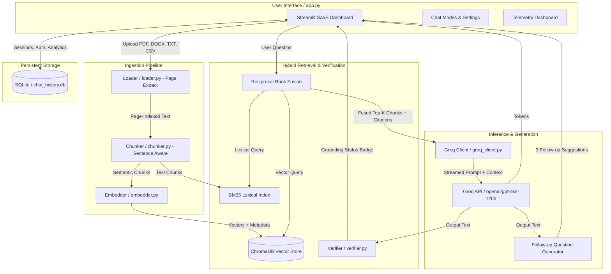

# 🧠 NexusRAG — Enterprise AI Document Intelligence Platform

A production-grade **Retrieval-Augmented Generation (RAG)** platform powered by **Groq**, **ChromaDB**, **Sentence Transformers**, and **SQLite**, designed for accurate, evidence-backed document inquiry and intelligence.

---

## 🌟 Key Features

### 🔍 Advanced Hybrid Retrieval & Reranking
- **Dense Vector Search**: Powered by `all-MiniLM-L6-v2` via ChromaDB cosine similarity.
- **Sparse BM25 Lexical Search**: High-precision keyword, code, and acronym matching.
- **Reciprocal Rank Fusion (RRF)**: Combines dense semantic and sparse lexical rankings for maximum retrieval precision.
- **Sentence-Boundary Aware Chunking**: Overlapping chunks that respect punctuation and paragraph boundaries.
- **Page-Level Metadata**: Preserves document name and exact page numbers across all supported file types (PDF, DOCX, TXT, MD, CSV).

### 🛡️ Grounding Verification & Citations
- **Source Citations**: Displays source file names, page numbers, and calibrated relevance scores.
- **Context Passage Inspector**: Expandable inspection panel allowing users to verify the exact text chunks used to answer.
- **Factual Grounding Check**: Automatically verifies whether the generated response is factually supported by retrieved document text or falls back to general knowledge.

### 🎭 4 Document-Based Chat Modes
- 🔬 **Research Mode**: Comprehensive, rigorous, evidence-based responses with deep analysis and specific page citations.
- 💡 **Simple Mode**: Plain-English explanations, intuitive analogies, and approachable language.
- ⚙️ **Technical Mode**: Engineering-grade detail, specifications, architectural patterns, and exact data points.
- 📋 **Summary Mode**: Concise executive briefing with key findings and bulleted takeaways.

### 💡 Smart Follow-up Questions
- Automatically generates 3 context-aware follow-up questions after each response based on the document's content.
- Click any suggestion chip to submit it directly as your next query.

### 📊 Real-Time RAG Analytics & Telemetry
- Measures **real** performance benchmarks:
  - Document & chunk indexing counts.
  - End-to-end Retrieval Latency (ms).
  - LLM Response Latency (ms).
  - Average chunks retrieved per query.
  - Average calibrated relevance score (%).
- Recent query telemetry audit log.

### 🕒 Multi-Session Management & Chat Export
- Create, rename, search, and delete individual conversation sessions.
- Export transcripts as clean **TXT** or **Markdown** files with a single click.
- Authenticated per-user chat history stored securely in SQLite with bcrypt password hashing.

---

## 🚀 Quick Start

### 1. Clone the repository

```bash
git clone https://github.com/GNANESWARKOKKIRALA/Ai-RAG-Chatbot.git
cd Ai-RAG-Chatbot
```

### 2. Activate Virtual Environment & Install Dependencies

```bash
# Windows
.\venv\Scripts\activate

# Install dependencies
pip install -r requirements.txt
```

### 3. Configure Environment Variables

Create or edit your `.env` file:

```env
GROQ_API_KEY=your_groq_api_key_here
CHROMA_DB_PATH=./chroma_store
EMBED_MODEL=all-MiniLM-L6-v2
TOP_K_CHUNKS=4
LLAMA_MODEL=openai/gpt-oss-120b
```

### 4. Launch Application

```bash
streamlit run app.py
```

Open `http://localhost:8501` in your browser.

---

## 🏗️ Architecture & Pipeline Flow



---

## 📁 Project Structure

```
AI-RAG-CHATBOT/
├── app.py                  # Main Streamlit SaaS Application (Chat, Knowledge Base, Analytics, Settings)
├── requirements.txt        # Python package dependencies
├── README.md               # Architecture documentation & setup guide
├── .env                    # Environment variables (API keys, model configuration)
├── auth/
│   ├── auth.py             # Bcrypt password hashing & authentication logic
│   └── db.py               # SQLite user accounts & authentication database
├── rag/
│   ├── loader.py           # Multi-format document parser with page extraction
│   ├── chunker.py          # Sentence-aware text chunker with page metadata
│   ├── embedder.py         # SentenceTransformers embedding generation
│   ├── vector_store.py     # ChromaDB vector store operations
│   ├── hybrid_search.py    # BM25 lexical engine & Reciprocal Rank Fusion (RRF)
│   ├── retriever.py        # Hybrid retriever, latency measurement & citation builder
│   └── verifier.py         # Factual grounding and document verification
├── llm/
│   └── groq_client.py      # Groq inference, 4 chat modes, follow-up generator, streaming
└── utils/
    ├── helpers.py          # SQLite database migrations, sessions, export, analytics telemetry
    └── session.py          # Streamlit session state management
```

---

## 🛡️ License & Technology Attributions
- Built with [Groq](https://groq.com), [ChromaDB](https://www.trychroma.com/), [SentenceTransformers](https://sbert.net/), and [Streamlit](https://streamlit.io/).
